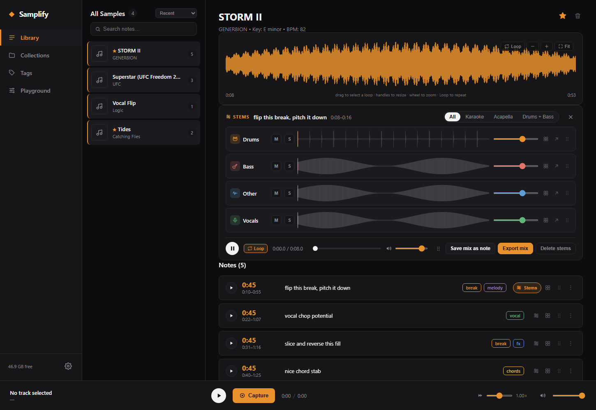

# Samplify

Capture a phrase while Spotify is playing, trim it on a waveform and use it to make something of your own. Samplify keeps a local sample library and gives you eight lanes in Playground to arrange captures, stems and recordings from disk.

https://github.com/user-attachments/assets/a41b334f-4351-4ec1-ac8f-59ce581f6cb5

**[Download for Windows](https://github.com/Joe-Hodge/Samplify/releases/latest)** · [Music and film credits](docs/demo/README.md) · [Platform and test status](docs/STATUS.md)

## Why it exists

Sampling from a streaming track usually takes four tools: a loopback recorder, an editor to trim the take, a stem splitter and a DAW to try ideas. By the time the phrase is ready, the idea has gone. Samplify keeps those steps in one window. It records only the Spotify player, remembers where in the song each take came from, splits stems on your own CPU and hands the result to your DAW as a WAV.

Everything stays on your machine. There is no account, no upload and no Spotify Web API key. Use captures for practice, study and your own productions, and clear samples before you release music that contains them.

## Make your first mix

1. Open Samplify and the **standalone Spotify desktop app** on Windows. In Samplify, choose **Settings → Set up or repair Spotify**. Spotify restarts with an orange **Capture** button in the playbar.
2. Play the song. When you hear a phrase you want to keep, click **Capture**. Drag the two edges on the waveform, loop the selection to audition it, then name and save it. The Library remembers the artist, track and song position.
3. Choose **Add to Playground** on the saved note. Use **Import audio** to bring in a drum loop or one of your own recordings. Give each lane a level and pan position, then choose which of the four bars it plays.
4. Press Play to hear the arrangement. Give it a name and choose **Save 4-bar mix**. **Export saved WAV** writes a stereo file to `Documents/Samplify/Exports`.

The playbar integration works without a Spotify Web API login. On Windows build 20348 or newer, the playbar records only the local Spotify player and its audio processes. The app button and hotkey also default to Spotify. To record other applications together, choose **Settings → Rolling Buffer → App button and hotkey → System audio (all apps)** and save. Start playback after selecting the source. [Spotify setup and troubleshooting](spicetify-ext/README.md)

## Inside the studio

| Tool | What you can do |
| --- | --- |
| **Capture card** | Freeze recent audio, audition or zoom a waveform, and set the selection by dragging or typing its start and end times. |
| **Library** | Search note text, favorite a track, rate a take, and organize samples by tag or collection. The Spotify seekbar shows markers for saved notes. |
| **Stem Mixer** | Split a clip locally into drums, bass, vocals and other instruments. Solo and combine parts, adjust their levels, then bounce, save, or drag the result to an audio editor. |
| **Playground** | Layer up to eight clips. Change the tempo, shift a loop against the downbeat, mute or solo lanes, and switch individual bars on or off as the transport plays. |



## Run from source

**Windows x64** is the tested platform. Install Node.js 24, Rust through rustup, Microsoft C++ Build Tools with the **Desktop development with C++** workload, and WebView2. [Tauri Windows prerequisites](https://v2.tauri.app/start/prerequisites/#windows)

The **macOS port** targets Apple Silicon on macOS 14 or newer. Native build, system audio, Spotify and installation checks are pending. [macOS port and acceptance plan](docs/macos.md)

From the repository root, run the following commands. Rustup selects Rust 1.94.1 from the checked-in toolchain file. The model download is about 166 MB and is verified by SHA-256. After the download, stem separation runs on the CPU.

```sh
npm ci
npm run fetch-model
npm run tauri dev
```

To build the Windows installer, run `npm run tauri build -- --bundles nsis`. The result is written under `src-tauri/target/release/bundle/nsis/`.

## Development

```sh
cargo test --manifest-path src-tauri/Cargo.toml
npm test
```

The default Rust suite uses a stand-in separator. To include the two real-model tests, set `SAMPLIFY_CLIP` to the absolute path of a short stereo WAV, then run `cargo test --manifest-path src-tauri/Cargo.toml --lib -- --include-ignored --test-threads=1`. The audition test writes four stems to `src-tauri/target/stem-audition/`.

To explore the UI with demo data, run `python -m http.server 8765 --bind 127.0.0.1` at the repository root and open [the library preview](http://127.0.0.1:8765/preview/library.html). Real audio capture, file export and desktop shortcuts use the native app.

[Architecture and data flow](docs/architecture.md) · [Verification notes](docs/STATUS.md) · [Roadmap](docs/ROADMAP.md)

## Credits and license

Samplify is developed by Joe Hodge and distributed under the MIT License. Spotify and Spicetify are independent projects. [MIT License](LICENSE) · [Spicetify](https://spicetify.app/)

Stem separation uses Meta AI’s HT-Demucs, StemSplit’s ONNX conversion, ONNX Runtime through the Rust `ort` crate, and `rubato` for resampling. StemKit inspired the mixer interaction. [HT-Demucs](https://github.com/facebookresearch/demucs) · [ONNX model](https://huggingface.co/StemSplitio/htdemucs-onnx) · [Bundled notices](src-tauri/notices/) · [StemKit](https://github.com/danielravina/stemkit)
