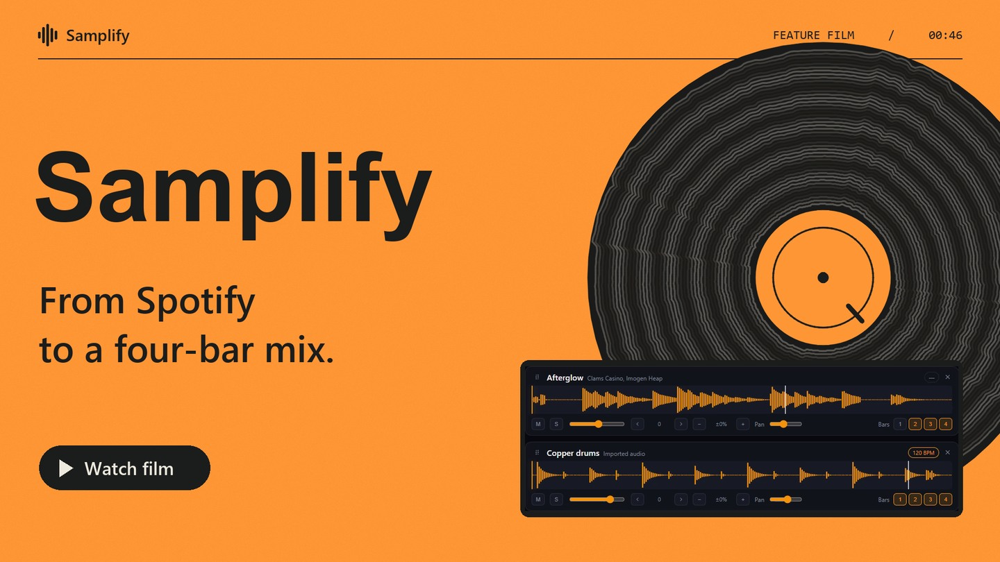

# From Spotify to a four-bar mix

The 46-second film uses OpenScreen recordings of Spotify desktop, Samplify on Windows and the exported WAV open in Audacity. The capture card and Playground show a real session. The music heard throughout is a separately mixed, licensed score.

| Time | On screen |
| --- | --- |
| 0:03 | Capture in the Spotify playbar |
| 0:07 | Drag the waveform edges and save the take |
| 0:14 | Find the sample by search, tag or collection |
| 0:19 | Open the four-stem mixer and solo drums and bass |
| 0:27 | Import a drum recording and switch Playground bars |
| 0:37 | Save the arrangement and reopen the stereo WAV in Audacity |

**Music** — *District Four* by Kevin MacLeod (incompetech.com), used under Creative Commons Attribution 4.0 International. The recording was excerpted, separated with Samplify’s HT-Demucs pipeline, remixed and faded for the film. At 0:22 the score drops to the drums and bass from that separation. From 0:27 to 0:38, the audio is an actual four-bar, 88 BPM stereo bounce exported by Playground. The third bar drops the guitar and organ. [Original track](https://incompetech.com/music/royalty-free/index.html?isrc=USUAN1600039) · [CC BY 4.0](https://creativecommons.org/licenses/by/4.0/)
